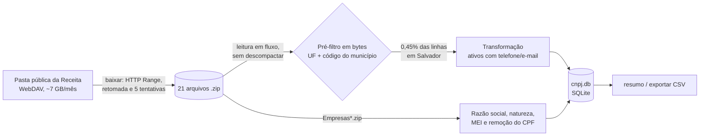

# cnpj-aberto-etl


ETL dos **dados abertos do CNPJ** da Receita Federal: transforma ~7 GB de CSVs compactados (todas as empresas do Brasil) num **SQLite pequeno e consultável**, só com os estabelecimentos ativos e com contato dos municípios escolhidos.

Feito para prospecção B2B e análises locais (quantos restaurantes, salões ou oficinas existem num bairro, quantos são MEI, etc.) num notebook comum: **i5 de 4ª geração, 8 GB de RAM, HD externo USB 2.0.**

## O problema

- A base completa tem **73,8 milhões de linhas** de estabelecimentos (out/2026) em 21 arquivos `.zip`.
- Carregar isso em pandas não cabe em 8 GB de RAM.
- Quase tudo é descartável para um uso local: empresas baixadas, de outros municípios ou sem nenhum contato.
- O download pela pasta pública da Receita cai com frequência.

## Resultado real (Salvador, out/2026)

| Etapa | Números |
|---|---|
| Linhas lidas (Estabelecimentos) | 73.809.386 |
| Estabelecimentos ativos com contato guardados | **329.729** (0,45%) |
| Tempo da etapa de estabelecimentos | ~14 min, lendo de HD externo USB 2.0 |

## Como funciona



**Decisões de engenharia**

| Decisão | Por quê |
|---|---|
| Ler o CSV de dentro do `.zip` em fluxo (`zipfile` + iteração por linha) | Memória constante, independente do tamanho da entrada |
| Pré-filtro em **bytes** (`"BA";"3849";` na linha crua) antes de decodificar o CSV | Descarta 99,5% das linhas sem custo de parsing; é o que torna viável num i5-4210U |
| Duas passagens: Estabelecimentos → Empresas | A segunda só atualiza os CNPJs básicos já guardados (conjunto em memória) |
| Gravar em `cnpj.novo` e trocar com `os.replace` no fim | Uma consulta nunca vê um banco pela metade; se o processo cair, o banco anterior continua válido |
| Inserção em lote por arquivo + `commit` | Um `executemany` por arquivo em vez de milhões de transações |
| `os.nice(15)` no processamento | Rodada longa que não trava o resto da máquina |
| Só biblioteca padrão | Roda em qualquer Python 3.10+, sem `pip install` |

**Privacidade (LGPD):** a base da Receita traz o CPF no fim da razão social do MEI. O ETL **remove o CPF** e guarda só o selo `mei = 1`. A base resultante tem apenas dados cadastrais públicos de pessoas jurídicas.

## Uso

```bash
python3 cnpj_etl.py listar                          # meses disponíveis e tamanho
python3 cnpj_etl.py baixar 2026-10                  # ~7 GB, retoma se parar
python3 cnpj_etl.py processar 2026-10 "Salvador" BA "Lauro de Freitas" BA
python3 cnpj_etl.py resumo --top 10                 # CNAEs com mais estabelecimentos
python3 cnpj_etl.py exportar --cnae 5611 --cnae 5620 --saida alimentacao.csv
```

A pasta de dados é `./dados`; use `--pasta /outro/lugar` ou a variável `CNPJ_DADOS`.

### Esquema

`estab(cnpj, basico, fantasia, razao, natureza, mei, cnae, cnaes_sec, endereco, bairro, cep, municipio_nome, uf, tel1, tel2, email, inicio)` com índice em `(municipio_nome, cnae)`, e `info(chave, valor)` com o mês de referência, os municípios e a data do processamento.

```sql
-- Bairros de Salvador com mais restaurantes ativos
SELECT bairro, COUNT(*) AS n
FROM estab
WHERE municipio_nome = 'SALVADOR' AND cnae LIKE '5611%'
GROUP BY bairro ORDER BY n DESC LIMIT 10;
```

## Testes

```bash
pip install pytest ruff
ruff check . && pytest -q
```

Os testes geram arquivos `.zip` sintéticos no mesmo formato da Receita (dados inventados) e conferem os filtros (situação ativa, contato válido, município), a remoção do CPF do MEI e a exportação. O CI roda a cada push.

## Próximos passos

- Exportar também em Parquet para uso em DuckDB/Power BI.
- Tabela de CNAEs com descrição (CONCLA/IBGE) para o `resumo` mostrar nomes.
- Agendamento mensal (systemd timer ou GitHub Actions) com comparação entre meses: empresas abertas e fechadas.

## Origem

Extraído da ferramenta de prospecção que desenvolvo para vender sites a pequenos negócios de Salvador, onde alimenta campanhas por nicho (CNAE) com deduplicação e lista de "não contatar".

## Licença

MIT. Os dados são da Receita Federal, publicados como dados abertos.
